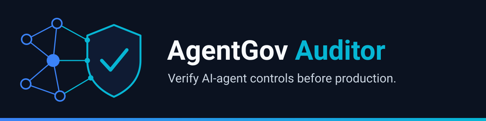
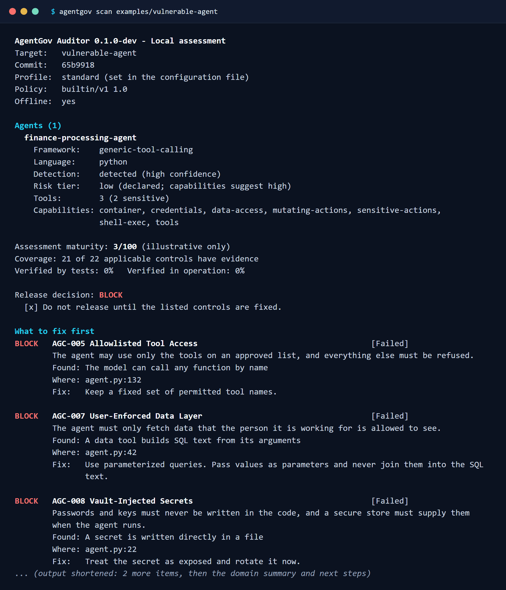
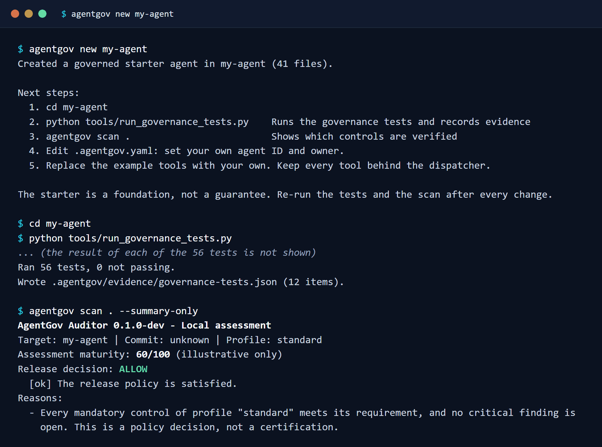
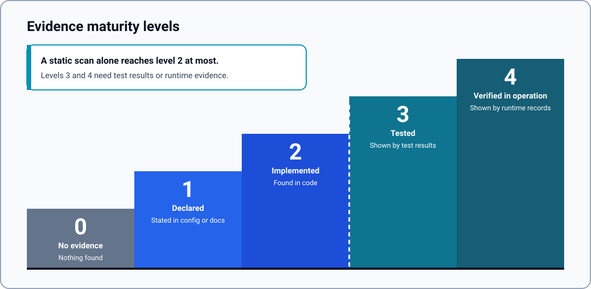
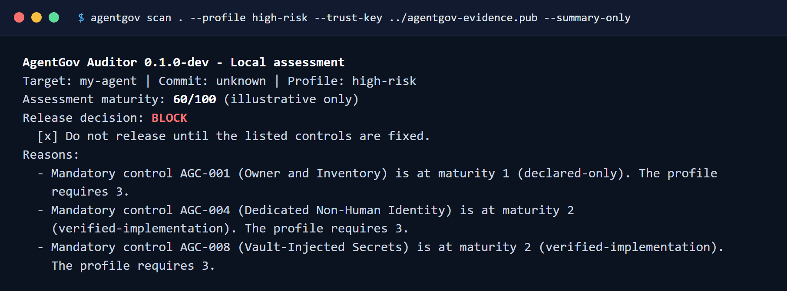
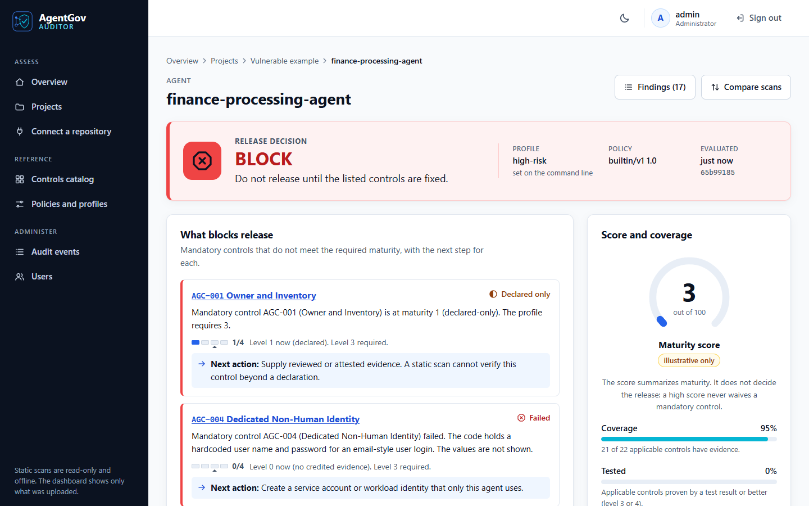
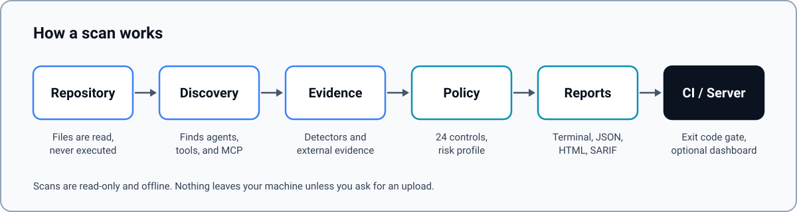

<p align="center">
  
</p>

AgentGov Auditor is a free command-line tool that scans a folder for AI agents and tells you which of 24 governance controls have real evidence behind them.

[](https://github.com/shahzadarain/agent-governance-auditor/actions/workflows/ci.yml)
[](LICENSE)
[](docs/known-limitations.md)
[](go.mod)

[Quick start](#quick-start) · [Step-by-step guide](docs/getting-started.md) · [Use cases](docs/use-cases.md) · [Controls](#the-24-controls) · [How scoring works](docs/scoring.md) · [GitHub Action](#add-it-to-github-actions) · [Dashboard](#self-hosted-dashboard) · [Contribute](CONTRIBUTING.md)

## What it does

- It finds the AI agents in a folder: the framework, the tools the agent can call, and what those tools can touch.
- It checks 24 controls, such as "a person approves risky actions" and "there is a way to stop the agent".
- It gives one release decision: `ALLOW`, `REVIEW REQUIRED`, or `BLOCK`, with the file and line for each problem and the steps to fix it.
- It runs on your machine. It needs no account, no API key, and no network. It reads files and never runs them.

A code scanner tells you where a bug is. This tool answers a different question: for each control, how strong is the proof? It keeps "someone wrote that it exists", "the code is there", "tests passed", and "we could not tell" apart, and it never merges them into one green tick.

## What a scan looks like

This is a scan of the deliberately unsafe example in this repository. The picture shows the top of the output.



The same output as text, shortened:

```text
$ agentgov scan examples/vulnerable-agent
AgentGov Auditor 0.1.0-dev - Local assessment
Target:   vulnerable-agent
Profile:  standard (set in the configuration file)
...
Assessment maturity: 3/100 (illustrative only)
Coverage: 21 of 22 applicable controls have evidence
Verified by tests: 0%   Verified in operation: 0%

Release decision: BLOCK
  [x] Do not release until the listed controls are fixed.

What to fix first
BLOCK   AGC-005 Allowlisted Tool Access                                     [Failed]
        The agent may use only the tools on an approved list, and everything else must be refused.
        Found: The model can call any function by name
        Where: agent.py:132
        Fix:   Keep a fixed set of permitted tool names.
...
```

## Quick start

The project is in alpha. The first release is `v0.1.0-alpha.1`. You can download a ready-built program, or build from source with Go.

### 1. Install

**Option A: download.** You do not need Go.

1. Open the [Releases page](https://github.com/shahzadarain/agent-governance-auditor/releases).
2. Download the file for your system: `windows_amd64.zip` for most Windows computers, `darwin_arm64.tar.gz` for a Mac with Apple silicon, `darwin_amd64.tar.gz` for an Intel Mac, `linux_amd64.tar.gz` for most Linux computers.
3. Unpack it. The folder holds one program: `agentgov.exe` on Windows, `agentgov` elsewhere.
4. Open a terminal in that folder and run `.gentgov.exe version` (Windows) or `./agentgov version` (macOS, Linux).

The binaries are not code-signed. Windows SmartScreen or macOS Gatekeeper can show a warning the first time. Each release includes a checksums file and build provenance, so you can check the download first: `gh attestation verify <file> --repo shahzadarain/agent-governance-auditor`.

The download holds the tool only. Run `agentgov new my-agent` to create a starter agent to scan, or use Option B to get the example agents.

**Option B: build from source.** You need [Go](https://go.dev/dl/) 1.27 or newer. You also get the example agents this way.

Windows (PowerShell):

```powershell
git clone https://github.com/shahzadarain/agent-governance-auditor.git
cd agent-governance-auditor
go build -o agentgov.exe ./cmd/agentgov
```

macOS or Linux:

```sh
git clone https://github.com/shahzadarain/agent-governance-auditor.git
cd agent-governance-auditor
go build -o agentgov ./cmd/agentgov
```

If you only want the tool and not the examples, one command installs it into your Go bin folder on any system:

```sh
go install github.com/shahzadarain/agent-governance-auditor/cmd/agentgov@latest
```

### 2. Scan

Scan the two example agents that ship with the repository. One is unsafe on purpose. The other has the controls in place.

Windows (PowerShell):

```powershell
.\agentgov.exe scan examples\vulnerable-agent
.\agentgov.exe scan examples\safe-agent
```

macOS or Linux:

```sh
./agentgov scan examples/vulnerable-agent
./agentgov scan examples/safe-agent
```

To scan your own project, point the tool at its folder. If you installed with `go install`, the command is `agentgov` without the leading `./`.

```sh
agentgov scan path/to/your/project
```

### 3. Read the result

Look at the line that starts with `Release decision`. Then read "What to fix first". Each item names the control, what was found, the file and line, and the first step of the fix.

Two commands help from here:

```sh
agentgov scan examples/vulnerable-agent --open
agentgov explain AGC-010
```

The first opens a visual report in your browser. The second explains one control in plain words.

New to the terminal? The [step-by-step guide](docs/getting-started.md) starts from "how do I open a terminal" and shows a picture for every step.

## Start a new governed agent

If you are starting from zero, begin with a small agent that already has the controls and the tests that prove them.

```sh
agentgov new my-agent
cd my-agent
python tools/run_governance_tests.py
agentgov scan .
```

The starter is plain Python with no third-party packages. `run_governance_tests.py` runs 56 tests and writes the result as an evidence file. The scan then reads that file.



## How to read the result

### Statuses

Every control gets one status. The words are always shown, so the result does not depend on color.

| Status | What it means |
| --- | --- |
| Verified in operation | There is proof from the running system. |
| Verified by tests | Tests that try to break the control passed for this exact version of the code. |
| Implemented (not yet tested) | The code is there. Nobody has shown that it works. |
| Declared only | A file says the control exists. That is all. |
| Missing | The tool looked for the control and did not find it. |
| Failed | The tool found something that breaks the control. |
| Unknown (needs evidence) | The tool cannot judge this from the code. It needs proof from you. |
| Not applicable | The agent has no capability that this control covers. |
| Accepted risk | A named person accepted the gap in writing, with an end date. |

### Decisions

| Decision | What it means | Exit code with the default `--fail-on block` |
| --- | --- | --- |
| `ALLOW` | Every required control meets the level your profile asks for. | 0 |
| `REVIEW REQUIRED` | A person must look before release. For example, no agent was found. | 0 |
| `BLOCK` | A required control failed, is missing, or is below the required level. | 1 |

Exit code 2 means the scan could not run. It is never a policy result.

### Maturity levels



Reading code can take a control to level 2 and no further. Levels 3 and 4 need evidence files from your tests or your running system. See [docs/evidence.md](docs/evidence.md).

### A score of 60 that is still blocked

The score is a summary for people. It does not decide the release. This is the starter agent from the section above, scanned with the strictest profile and with signed test evidence:



The same agent gets `ALLOW` under the `standard` profile. Under `high-risk`, twelve controls are mandatory and each must be proven by tests. Three of them are not, so the release is blocked. The score did not change. See [docs/scoring.md](docs/scoring.md) for the formula and [docs/policy-reference.md](docs/policy-reference.md) for the profiles.

## Add it to GitHub Actions

Save this as `.github/workflows/agentgov.yml`:

```yaml
name: AgentGov

on:
  pull_request:
  push:
    branches: [main]

permissions:
  contents: read

jobs:
  scan:
    runs-on: ubuntu-latest
    steps:
      - uses: actions/checkout@3d3c42e5aac5ba805825da76410c181273ba90b1 # v7.0.1
        with:
          persist-credentials: false
      - uses: shahzadarain/agent-governance-auditor@main
        with:
          path: .
          fail_on: block
```

The example follows `main`. A branch can change. For real use, replace `main` with a full commit SHA that you have reviewed.

What the job does:

- It builds the CLI from the source at the ref you pinned. It downloads no binary.
- It writes the Markdown summary to the job page.
- It saves the JSON, SARIF, Markdown, and HTML reports as an artifact named `agentgov-reports`.
- It fails the job when the decision is `BLOCK`. A scan error fails with exit code 2 and a different message, so you can tell the two apart.

Optional: set `upload_sarif: "true"` to send findings to GitHub code scanning. Code scanning is available for public repositories and for private repositories with GitHub Code Security. Where it is not available, that one step fails and the rest of the job still runs, including the release decision.

The action is exercised by this repository's own CI workflow, which scans both examples through it. See the CI badge at the top for the current state. Full reference: [docs/github-action.md](docs/github-action.md).

## The 24 controls

The controls are this project's own model, grouped into six domains. Open a domain to see its controls. The full definitions are in [docs/control-catalog.md](docs/control-catalog.md), and `agentgov explain <ID>` prints any of them.

<details>
<summary><strong>A: Accountability</strong> (3 controls)</summary>

| ID | Control | In plain words |
| --- | --- | --- |
| AGC-001 | Owner and Inventory | A named person or team must be responsible for the agent, and the agent must be listed with what it does and what it can use. |
| AGC-002 | Dynamic Risk Tiering | The agent must have a risk level that matches what it can really do, and someone must explain and approve that level. |
| AGC-003 | Integrated Change Control | When the agent's model, tools, or permissions change, the change must be reviewed and checked again before release. |

</details>

<details>
<summary><strong>B: Identity and Access</strong> (5 controls)</summary>

| ID | Control | In plain words |
| --- | --- | --- |
| AGC-004 | Dedicated Non-Human Identity | The agent must use its own account, not a staff member's login or a shared password. |
| AGC-005 | Allowlisted Tool Access | The agent may use only the tools on an approved list, and everything else must be refused. |
| AGC-006 | Short-Lived Scoped Tokens | The agent's access keys must expire quickly and must open only what the agent needs. |
| AGC-007 | User-Enforced Data Layer | The agent must only fetch data that the person it is working for is allowed to see. |
| AGC-008 | Vault-Injected Secrets | Passwords and keys must never be written in the code, and a secure store must supply them when the agent runs. |

</details>

<details>
<summary><strong>C: Action Controls</strong> (5 controls)</summary>

| ID | Control | In plain words |
| --- | --- | --- |
| AGC-009 | External Policy Engine | Fixed rules outside the AI model must decide whether a risky action is allowed, and the answer must be no when the rules cannot be checked. |
| AGC-010 | Human Approval Gates | A person must approve risky actions before the agent carries them out. |
| AGC-011 | Dual Content Guardrails | What goes into the agent and what comes out must both be checked, so hidden instructions and sensitive data do not slip through. |
| AGC-012 | Multi-Level Resource Limits | The agent must have firm limits on how long it runs, how much it spends, and how many actions it takes. |
| AGC-013 | Disposable Sandbox Environments | Anything the agent runs must happen in a locked-down, throwaway workspace that cannot harm real systems. |

</details>

<details>
<summary><strong>D: Trust Boundaries</strong> (3 controls)</summary>

| ID | Control | In plain words |
| --- | --- | --- |
| AGC-014 | Vetted Tool Supply Chain | The outside tools and software the agent relies on must come from known sources and be fixed to checked versions. |
| AGC-015 | Context Memory Integrity | What the agent remembers must be checked before it is saved, kept separate for each user, and protected from tampering. |
| AGC-016 | Authenticated Inter-Agent Messages | When agents talk to each other, each one must prove who it is, and messages must be protected from forgery. |

</details>

<details>
<summary><strong>E: Containment and Recovery</strong> (3 controls)</summary>

| ID | Control | In plain words |
| --- | --- | --- |
| AGC-017 | Instant Agent Kill Switch | Someone must be able to stop the agent immediately, and the stop must actually end its actions. |
| AGC-018 | Reversible Action Design | When the agent changes something, there must be a way to undo it, or a clear approval for anything that cannot be undone. |
| AGC-019 | Dedicated Incident Runbook | There must be a written and practiced plan for what to do when the agent goes wrong. |

</details>

<details>
<summary><strong>F: Assurance and Visibility</strong> (5 controls)</summary>

| ID | Control | In plain words |
| --- | --- | --- |
| AGC-020 | Mandatory Regression Evals | The agent must pass a fixed set of tests, covering what it should and should not do, before every release. |
| AGC-021 | Continuous Red Teaming | People or tools must regularly try to trick or break the agent, in a safe test setting, to find weaknesses first. |
| AGC-022 | Complete Step Tracing | Every step the agent takes must be recorded so people can later see exactly what it did and why. |
| AGC-023 | Tamper-Evident Audit Trail | The record of what the agent did must be protected so that nobody can secretly change or delete it. |
| AGC-024 | Real-Time Operational Monitoring | The agent must be watched while it runs, and unusual behavior must raise an alert that reaches a person. |

</details>

What each detector really looks for, control by control, is in the [coverage matrix](docs/CONTROL_COVERAGE.md).

## What it can and cannot verify

| It can | It cannot |
| --- | --- |
| Find agents built with the frameworks listed below, in Python, TypeScript, and JavaScript. | See agents in other languages, or behind frameworks it does not know. |
| Show that code for a control exists, with the file and line. | Show that the code works. That needs tests or runtime records that you supply. |
| Find clear violations, such as a secret written in a file or SQL built from tool arguments. | Find every bug. It reads code as text with knowledge of each language. It is not a compiler. |
| Check that test evidence belongs to the exact files it claims to cover. | Run your tests for you. A scan never executes code from the scanned folder. |
| Block a release when a required control is not met. | Stop an agent at run time. It audits. It does not sit inside your agent. |
| Say "unknown" when it cannot tell. | Certify anything. A good result does not mean an agent is safe. |

The full list of limits is in [docs/known-limitations.md](docs/known-limitations.md).

## Privacy

- Scans are offline. The tool makes no network connection during a scan.
- There is no telemetry and no usage tracking.
- The tool reads files. It never runs code, installs packages, or imports modules from the folder it scans.
- Files that look like secret stores, such as `.env` and private keys, are listed but not opened.
- Nothing leaves your machine unless you pass `--upload-url` to send a result to a server that you run. That upload holds the scan result, not your source code.

Details: [docs/privacy.md](docs/privacy.md).

## Self-hosted dashboard

Status: beta. If you have several agents, you can run a dashboard on your own machine and have each build send its scan result to it. It lists every agent with its owner, tools, latest decision, and history. It listens on `127.0.0.1` only, stores data in a local SQLite file, and has no default password: the first start prints a one-time setup token.

```sh
agentgov serve
```



The SQLite path is tested. Docker and Compose files and a PostgreSQL option are shipped in `deploy/`, but they have not been verified yet, so treat them as starting points. Guides: [docs/dashboard.md](docs/dashboard.md), [docs/self-hosting.md](docs/self-hosting.md), [docs/deployment-security.md](docs/deployment-security.md).

## Supported frameworks

"Detected" means the scanner recognizes the framework's imports and how agents and tools are created with it. It does not mean every feature of the framework is understood.

| Framework | Python | TypeScript / JavaScript |
| --- | --- | --- |
| LangGraph | Detected | Detected |
| LangChain | Detected | Detected |
| OpenAI Agents SDK | Detected | Detected |
| CrewAI | Detected | Not covered |
| AutoGen | Detected | Not covered |
| PydanticAI | Detected | Not covered |
| MCP servers and clients, and MCP configuration files | Detected | Detected |
| Direct tool calling with a model SDK (OpenAI, Anthropic, Google, Mistral, Ollama, Vercel AI SDK, and others) | Detected | Detected |

Analysis of TypeScript and JavaScript is shallower than analysis of Python. Other languages are not scanned. Details and known gaps: [docs/framework-support.md](docs/framework-support.md).

## How it works



A scan walks the folder, extracts facts about agents and tools, runs one detector per control, adds any evidence files you supply, and applies your risk profile. Every report format is rendered from the same result, and the same input gives the same output. More in [docs/architecture.md](docs/architecture.md).

## Documentation

| Document | What it covers |
| --- | --- |
| [Step-by-step guide](docs/getting-started.md) | Install to first result, with a picture for every step. Start here. |
| [Use cases](docs/use-cases.md) | Seven situations the tool was built for, each with commands. |
| [Demo gallery](docs/demo-gallery.md) | The unsafe and the safe example side by side. |
| [Examples](examples/README.md) | What each example folder shows and its real result. |
| [CLI reference](docs/CLI.md) | Every command, flag, exit code, and environment variable. |
| [GitHub Action](docs/github-action.md) | Inputs, outputs, permissions, and pull request safety. |
| [Evidence](docs/evidence.md) | Static, tested, and runtime evidence; the evidence file format; signing. |
| [Control catalog](docs/control-catalog.md) | The 24 controls in full. |
| [Coverage matrix](docs/CONTROL_COVERAGE.md) | What each detector recognizes and where it stops. |
| [Scoring](docs/scoring.md) | The score formula and how the decision is made. |
| [Policy reference](docs/policy-reference.md) | `.agentgov.yaml`, profiles, baselines, and exceptions. |
| [Framework support](docs/framework-support.md) | What is detected per framework and language. |
| [Known limitations](docs/known-limitations.md) | What the tool does not do, stated plainly. |
| [Architecture](docs/architecture.md) | Data flow, packages, and how to add an adapter. |
| [Threat model](docs/threat-model.md) | Threats to the auditor itself and how each is handled. |
| [Troubleshooting](docs/troubleshooting.md) | Common problems on Windows, in CI, and with results. |
| [FAQ](docs/faq.md) | Short answers to common questions. |
| [Privacy](docs/privacy.md) | What is read, what is stored, and what is never sent. |
| [Dashboard](docs/dashboard.md) | A tour of the self-hosted dashboard. |
| [Self-hosting](docs/self-hosting.md) | Running, backing up, and upgrading the server. |
| [Deployment security](docs/deployment-security.md) | Hardening the server. |
| [Writing a detector](docs/contributing-rules.md) | How to add a rule with fixtures and tests. |

## Contributing

Bug reports, wrong results, and new detectors are all welcome. Start with [CONTRIBUTING.md](CONTRIBUTING.md). If the tool flagged something that is fine, or missed something obvious, use the "False positive or wrong result" issue template. Those reports become test fixtures.

## Security

Please do not report a vulnerability in a public issue. Use GitHub private vulnerability reporting on this repository. The process is in [SECURITY.md](SECURITY.md).

## Roadmap and license

Planned work is in [ROADMAP.md](ROADMAP.md) and changes are in [CHANGELOG.md](CHANGELOG.md).

Licensed under [Apache-2.0](LICENSE).

Built and maintained by Shahzad Asghar ([@shahzadarain](https://github.com/shahzadarain)).

## Disclaimer

AgentGov Auditor gives an evidence-based assessment. It is not a certification, an audit opinion, or a guarantee that an agent is safe. The control catalog is this project's own model. Published standards such as the OWASP Top 10 for Agentic Applications and the NIST AI Risk Management Framework are referenced for mapping only. This project is not endorsed by, or affiliated with, those bodies.
