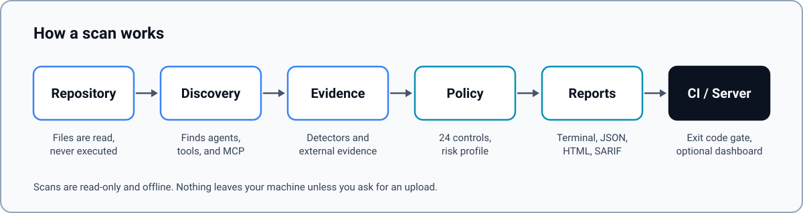

# Architecture

This page explains how a scan flows through the code, what each package does, the data model that every report is built from, and how to extend detection.

## Contents

- [Data flow](#data-flow)
- [Package map](#package-map)
- [The normalized model](#the-normalized-model)
- [Determinism](#determinism)
- [Design rules](#design-rules)
- [How to add a framework](#how-to-add-a-framework)
- [How to add a language](#how-to-add-a-language)
- [How to add a detector](#how-to-add-a-detector)

## Data flow



A scan is one pass through six stages. Each stage hands a plain data structure to the next.

1. **Discovery** (`internal/discovery`). Walks the folder and builds a list of files. It applies size, count, and depth limits, skips binary files and dependency folders, refuses symbolic links that leave the folder, and lists secret-store files without opening them. It also reads the commit from the `.git` folder. It never calls the `git` program.
2. **Adapters** (`internal/adapters`). Turn files into facts. A lexer for Python and one for JavaScript and TypeScript produce two views of each source file: one with comments and string contents blanked, and one with only comments blanked. From those views the adapters extract imports, functions, calls, and keyword arguments. YAML, JSON, TOML, Dockerfiles, and dependency manifests are parsed into documents. The adapters then decide which agents exist, which framework each uses, which tools it has, and what those tools can do.
3. **Detectors** (`internal/rules`). There is one detector per control. Each receives one agent with its files and facts and returns evidence items and, when it finds a violation, findings. A detector that panics is caught, and its control gets an error status, never a pass.
4. **External evidence** (`internal/evidence`). Loads the JSON files in `.agentgov/evidence/`, checks each item against the schema, checks its binding to file content or commit, its expiry, and its signature, and adds the items to the evidence list with a validity state.
5. **Policy** (`internal/policy`, `internal/scoring`). Loads the risk profile, merges the repository configuration and any organization baseline so that the result can only get stricter, decides whether each control applies, derives one status and one maturity level per control from the evidence, and then decides `ALLOW`, `REVIEW REQUIRED`, or `BLOCK`. The score is computed here too. It never feeds into the decision.
6. **Reporting** (`internal/reporting`). Renders the result as terminal text, JSON, Markdown, HTML, or SARIF. Every format is rendered from the same result object.

`internal/detect` runs stages 1 to 4 together. `internal/scanner` runs the whole pass and is what the CLI calls.

After the scan, the CLI sets the exit code from the decision and `--fail-on`. If you asked for an upload, it posts the result document to your server.

## Package map

| Path | Role |
| --- | --- |
| `cmd/agentgov` | The CLI: commands, flags, exit codes, color handling, upload. |
| `internal/model` | The single data model shared by every package. |
| `internal/config` | `.agentgov.yaml` types, loader, and validation. The file is a declaration and is never evidence. |
| `internal/discovery` | Read-only, bounded file inventory and commit lookup. |
| `internal/adapters` | Lexers, document readers, framework table, agent and tool extraction. |
| `internal/rules` | The static detectors, one per control. |
| `internal/evidence` | External evidence: loading, digests, signing, verification. |
| `internal/detect` | Runs discovery, adapters, detectors, and evidence loading as one step. |
| `internal/controls` | Loads and validates the embedded control catalog. |
| `internal/policy` | Profiles, tighten-only merging, status derivation, the release decision. |
| `internal/scoring` | The maturity score and the coverage numbers. |
| `internal/reporting` | The five output formats, the comparison of two results, and output sanitizing. |
| `internal/scanner` | Orchestrates one scan from options to result. |
| `internal/server` | The self-hosted API: sign-in, projects, tokens, scan ingestion. |
| `internal/storage` | Persistence for the server. SQLite is tested. PostgreSQL is experimental. |
| `policies/` | The control catalog, the risk profiles, and the JSON Schemas. All are embedded in the binary. |
| `web/` | Dashboard source (React, TypeScript, Vite). The built files are embedded in the binary. |
| `examples/` | Sample agents. `examples/safe-agent` is also the template for `agentgov new`. |
| `tests/fixtures/` | Small inputs for the detection tests, including a hostile repository. |

The binary has no runtime dependency. It is built without cgo, and the catalog, profiles, schemas, starter agent, and dashboard are compiled into it.

## The normalized model

Everything a scan learns is stored in one structure, `ScanResult`, defined in `internal/model/model.go`. The JSON output is that structure, and its schema is `policies/schema/scan-result.schema.json`. The field `schema_version` is `"1"`.

Top-level keys of a result:

| Key | Holds |
| --- | --- |
| `tool`, `scan` | Tool version, scan ID, times, target name, commit, profile and where it came from, policy pack and version. |
| `agents` | One entry per agent: ID, framework, language, detection state, tools, capabilities, declared and inferred risk tier, MCP connections, and the facts that led to detection. |
| `evidence` | Every evidence item, static and external. |
| `findings` | Every violation, with rule ID, severity, location, explanation, fix steps, and standards mappings. |
| `assessments` | Per agent: its score, its decision, and the result for each of the 24 controls. |
| `score`, `decision` | Repository level. The decision is the most restrictive agent decision. The score is the lowest agent score. |
| `stats`, `warnings`, `limitations` | Files scanned and skipped, warnings, and the limits of this scan in words. |

The terms that matter most:

- **Evidence** has a `source_type` (`static`, `configuration`, `test`, `runtime`, `external-attestation`, `manual-review`), a `signal` (`present`, `absent`, `violation`, `declared`, `error`), a `strength` (`declared`, `implementation`, `tested`, `operational`), and a `validity` (`valid`, `expired`, `commit-mismatch`, `digest-mismatch`, `unbound`, `invalid-signature`, `malformed`).
- **Control status** is one of `verified-operational`, `verified-tested`, `verified-implementation`, `declared-only`, `missing`, `failed`, `unknown`, `not-applicable`, `accepted-risk`, `error`. Reports show these as words such as "Verified by tests".
- **Maturity** is 0 to 4 and follows from the status.
- **Decision** is `ALLOW`, `BLOCK`, or `REVIEW_REQUIRED`, with a list of reasons. Each reason has a stable code.

How status is derived from evidence is specified in [scoring.md](scoring.md).

## Determinism

The same input gives the same output. This matters for CI, for comparing two scans, and for trust in the result.

- No language model is involved in a scan. Detection is pattern matching, and policy is fixed rules.
- Files, agents, tools, evidence, findings, and warnings are sorted before output.
- The scan ID is a hash of the result content with times left out, so two scans of the same content have the same ID.
- Evidence IDs and finding fingerprints are derived from content. A fingerprint never includes a secret value.
- Percentages are rounded with integer arithmetic.
- Paths are relative to the scanned folder and use forward slashes on every system.

Only the timestamps and the duration differ between two runs. The tests `TestScanIsDeterministic` and `TestDeterminism` check this.

## Design rules

These rules shape the code. Changes that break one of them are not accepted.

- **Read, never run.** No code from the scanned folder is executed, imported, or installed.
- **Offline.** A scan makes no network connection. The only network code in the CLI is the opt-in upload.
- **Scanned content is untrusted.** Every string from a repository is cleaned before it reaches a terminal, HTML, Markdown, or SARIF.
- **A declaration is not evidence.** Configuration can raise a control to "Declared only" and no further.
- **Static evidence is capped.** It supports level 2 at most.
- **Configuration can tighten policy and cannot loosen it.**
- **The score never changes the decision.**
- **Unknown stays unknown.** A control that cannot be judged is not turned into a pass or a failure.

The threats behind these rules, and the tests that back them, are in [threat-model.md](threat-model.md).

## How to add a framework

For a framework in Python, TypeScript, or JavaScript, the work is one table entry and tests.

1. Open `internal/adapters/frameworks.go` and add an entry to the `Frameworks` table. An entry has an ID, the module names to match for Python and for JavaScript, the constructor names that show the framework is used (`Ctors`), method names that show use (`Methods`), and the package names as they appear in manifests. The order of the table is the order of preference when several frameworks match.
2. If the framework has its own tool decorator, add the name to `toolDecoNames` in `internal/adapters/tools.go`. If it has multi-agent constructors, add them to `multiAgentRe` in the same file.
3. Add cases to `internal/adapters/adapters_test.go`: one where the framework is imported and used (detected), one where it is only imported (suspected), and one where the name appears only in a comment or a string (not detected).
4. Add framework-specific control signals to the detectors where they exist. For example, an approval setting belongs in the `frameworkGates` list of the AGC-010 detector in `internal/rules/actions.go`.
5. Update the framework list in [framework-support.md](framework-support.md) and the "No AI agent was detected" text in `internal/adapters/agents.go`.
6. Run `go test ./internal/adapters/... ./internal/detect/... ./internal/rules/...`.

## How to add a language

A new language needs more than a table entry. Lexers sit behind the `Analyzer` interface in `internal/adapters/source.go`:

```go
Language() string
Version() string
Extensions() []string
Analyze(path string, content []byte) *Source
```

An analyzer must produce the two views of the file (code and text) and fill in imports, functions, calls, and keyword arguments. There is no registry for analyzers yet. The dispatch in `internal/adapters/repo.go` names the Python and JavaScript analyzers directly, and a few places check file extensions. Open an issue before you start, so we can agree on the approach.

## How to add a detector

Detectors are listed in `internal/rules/rules.go` and live in one file per domain. The guide is [contributing-rules.md](contributing-rules.md). The short version: a detector belongs to exactly one control, works on the adapter views and not on raw text, states its limitations in every evidence item, and comes with positive, negative, and malformed test cases.
