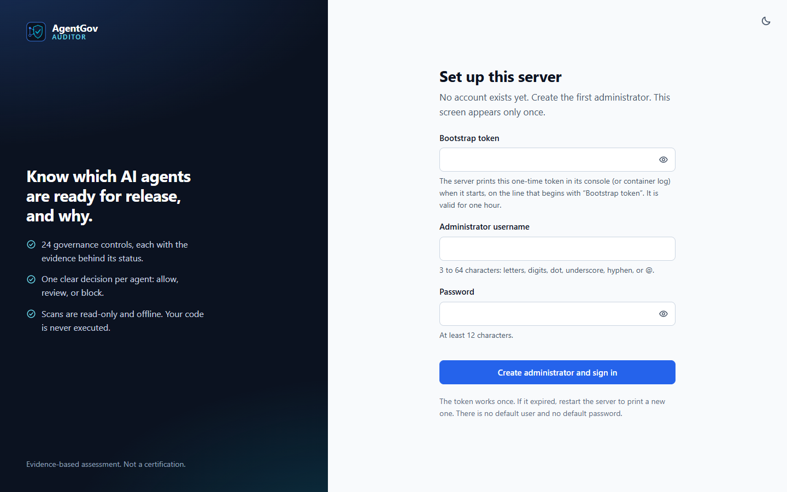
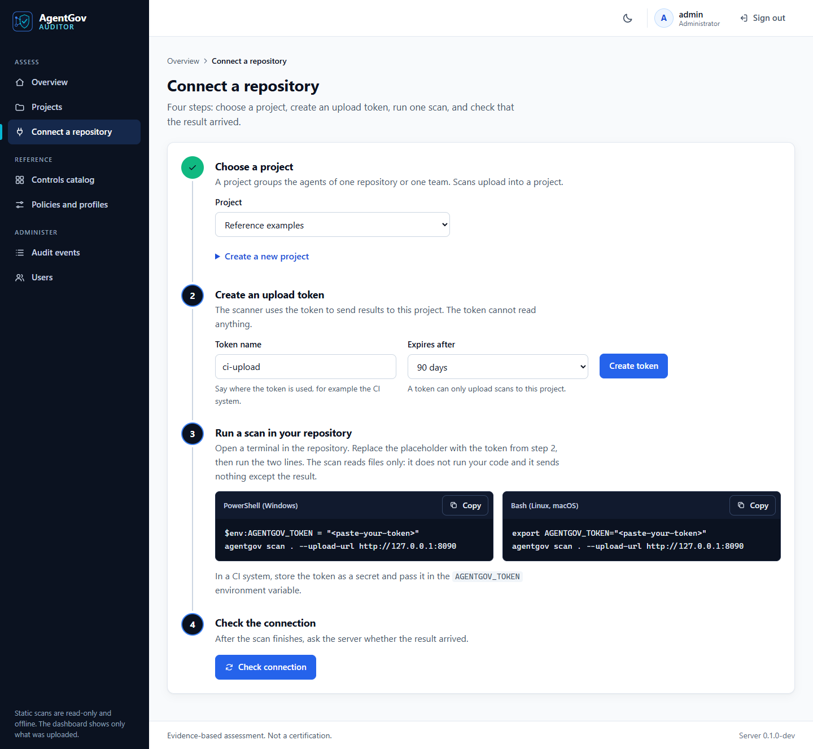
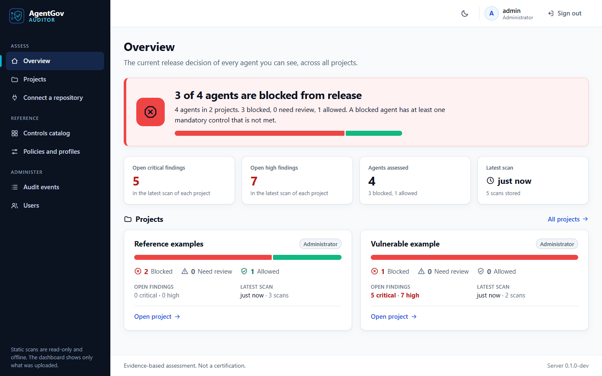
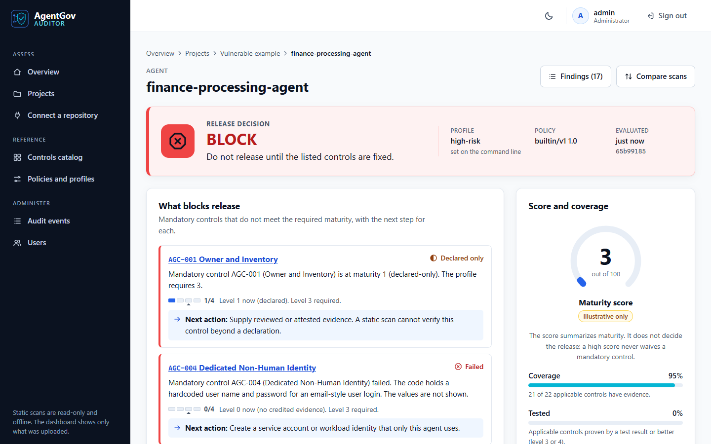
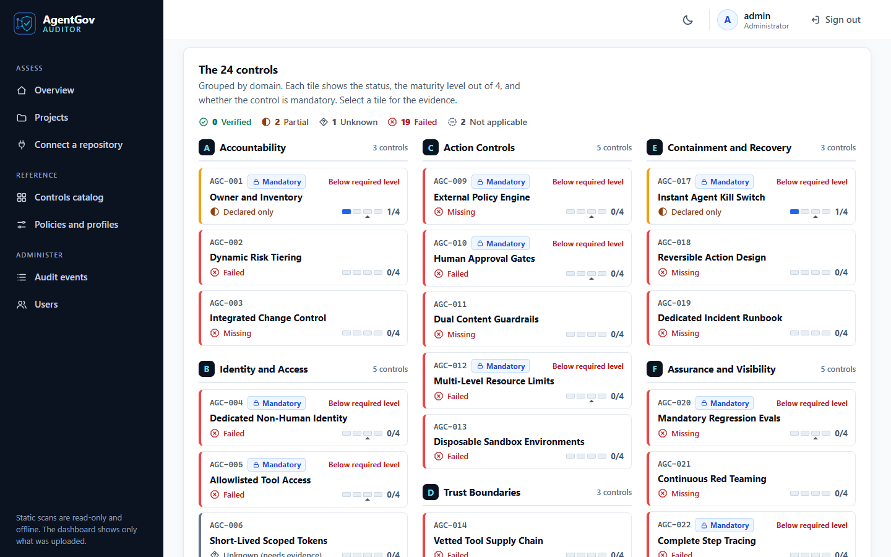
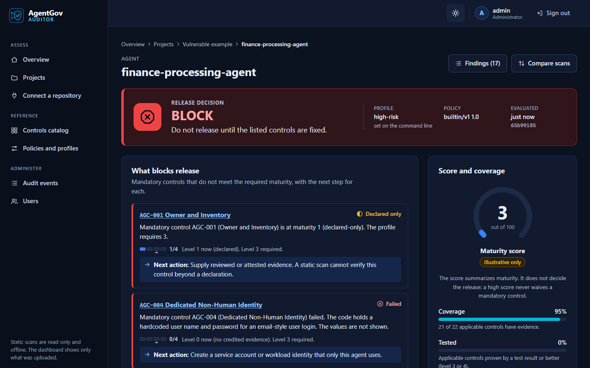
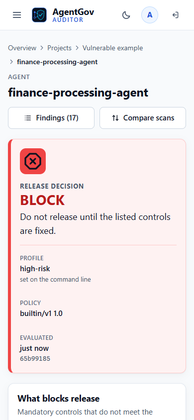
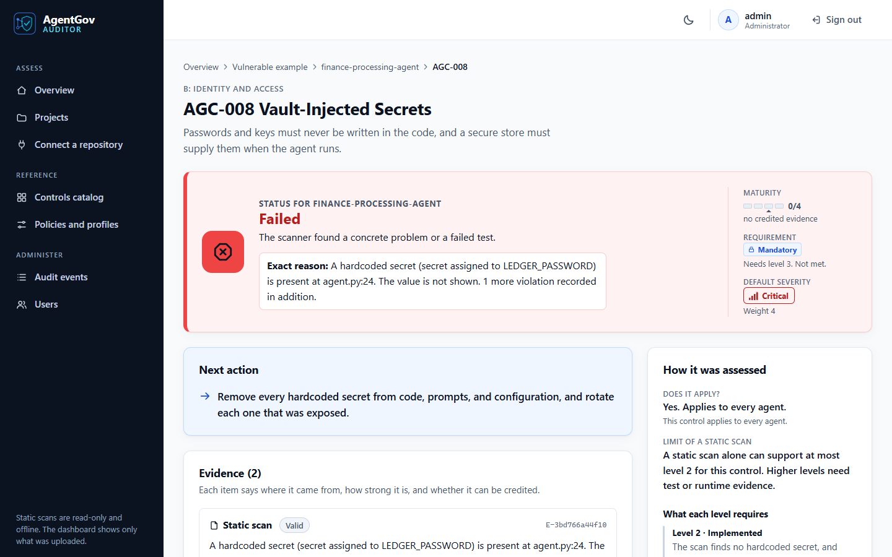
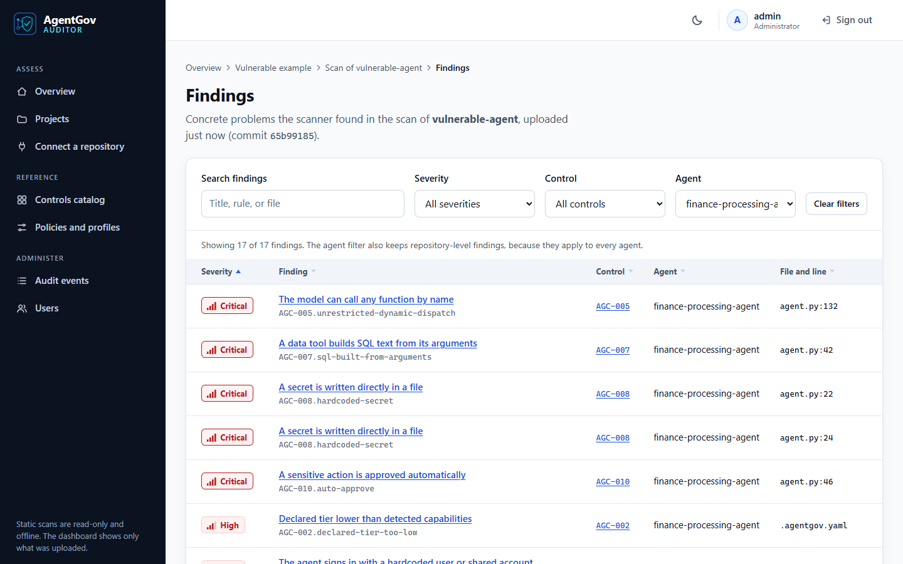
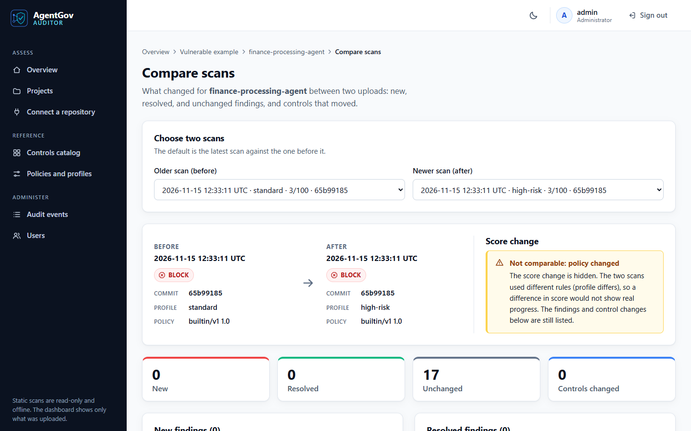

# Web dashboard

The dashboard shows the scans that the CLI uploads to a self-hosted AgentGov
server. It is for engineers and for risk owners who have no security
training. It is optional: the CLI works without it.

The dashboard ships inside the `agentgov` binary. Start the server and open
its address in a browser:

```sh
agentgov serve            # http://127.0.0.1:8080
```

See [self-hosting.md](self-hosting.md) for server configuration.

Everything on screen comes from the server API. The dashboard holds no sample
data and has no demo mode. The pictures below show the four example agents in
`examples/`, scanned and uploaded by the CLI.

Every page ends with the line "Evidence-based assessment. Not a
certification."

## Visual tour

### First-run setup



**Answers:** how do I create the first account?
The screen appears only while the server has no user. Paste the one-time
bootstrap token from the server console, choose a username, and choose a
password of at least 12 characters. There is no default user and no default
password.

### Connect a repository



**Answers:** how do I get my first scan into the dashboard?
Four steps: choose or create a project, create an upload token, run the scan
command (shown for PowerShell and for Bash, with copy buttons), and select
"Check connection". The check asks the server whether a scan arrived and says
so either way. A new token is shown once and is never stored by the browser.
An empty server shows this guide as its start page.

### Overview



**Answers:** are my agents ready for release?
One sentence states the result, for example "3 of 4 agents are blocked from
release". Below it: open critical and high findings, the number of agents,
the time of the latest scan, and one card per project.

### Agent detail



**Answers:** can this agent be released, and if not, what must change?
The banner gives the decision (ALLOW, REVIEW REQUIRED, or BLOCK) in one
sentence. "What blocks release" lists each mandatory control that falls
short, with the reason and the next action. The score dial is labeled
"illustrative only": the score never decides the release.



The same page shows the 24 controls in their six domains. Each tile has the
control ID, the title, a status label with an icon, the maturity level as
four segments, and a mark when the control is mandatory. The page also shows
evidence freshness (expired items and the oldest valid-until date), a score
history chart, and the facts the scan found about the agent.

The history chart joins two scans with a line only when they share the same
policy pack, policy version, and profile. Otherwise it shows a break and the
note "Not comparable: policy changed".

Dark theme and phone width:





### Control detail



**Answers:** why does this control have this status?
Plain-language meaning, the status and its exact reason, how the control was
assessed, each evidence item (source, strength, validity, integrity, observed
and valid-until dates, summary), limitations, remediation steps, related
findings, and standards references. References are labeled "Reference only,
not certification".

### Findings



**Answers:** which concrete problems did the scan find, and where?
Filter by severity, control, and agent, or search by text. A finding page
shows the severity, the file and line, why it matters, the remediation steps,
the evidence, and a link to its control.

### Compare scans



**Answers:** what changed between two uploads of this agent?
New, resolved, and unchanged findings, and controls whose status or maturity
moved. The default is the latest scan against the one before it. When the two
scans used a different policy pack, policy version, or profile, the server
reports them as not comparable. The dashboard then hides the score change and
states the reason. The picture shows that case: the same example scanned with
the `standard` and the `high-risk` profile.

### Other screens

| Screen | Answers |
| --- | --- |
| Projects | Which projects can I see, and what is my role in each? |
| Project detail | Agent inventory (sort and filter), recent scans, members, upload tokens. |
| Scan | What did one upload contain? Agents, warnings, limitations. A scan that found no agent says that this is not a pass. |
| Controls catalog | What does each of the 24 controls require at each maturity level? |
| Policies and profiles | Which controls does each profile make mandatory? Read-only. |
| Audit events | Who signed in, uploaded, or changed projects, members, and tokens? |
| Users | Accounts on the server (administrators only). |

## Roles

A user has one server role and, per project, at most one project role. A
user who is not a member of a project gets "not found" for everything in it.
The server enforces these rules. The dashboard hides or explains what a role
cannot do.

| Role | Can do |
| --- | --- |
| Administrator (server) | Everything in every project. Create projects and users. See all audit events. |
| User (server) | Nothing alone. Sees only the projects that list the user as a member. |
| Owner (project) | Read everything in the project. Create and revoke upload tokens. Add and remove members. See the project's audit events. |
| Reviewer (project) | Read everything in the project. See the project's audit events. |
| Viewer (project) | Read everything in the project, except audit events. |

An upload token is not a user. It can upload scans to its one project and
can read nothing.

## Security properties

- The session is an HttpOnly cookie with SameSite=Strict. The dashboard
  cannot read it.
- The CSRF token is kept in memory only and sent as `X-CSRF-Token` on every
  request that changes data.
- The dashboard stores one value in the browser: the theme choice
  (`localStorage` key `agentgov-theme`). It stores no token and no password.
- All text from the server renders as text. The code never uses
  `dangerouslySetInnerHTML`. A standards link becomes a link only when its
  address starts with `http://` or `https://`, and it opens with
  `rel="noopener noreferrer"`.
- The bundle has no inline script, no external font, no CDN, and no
  analytics. It runs under the server's Content-Security-Policy
  (`script-src 'self'`).
- Runtime dependencies: `react`, `react-dom`, and `react-router-dom`. No UI
  kit, CSS framework, chart library, state library, or icon package.

## Development

Requirements: Node.js 20 or later and npm.

```sh
cd web
npm ci
```

| Command | What it does |
| --- | --- |
| `npm run dev` | Vite dev server on `http://127.0.0.1:5173`. It proxies `/api`, `/healthz`, and `/readyz` to `http://127.0.0.1:8080`, so start `agentgov serve` first. The dev server does not send the production Content-Security-Policy. |
| `npm run check` | Type check (`tsc --noEmit`) and unit tests (Vitest with jsdom). |
| `npm run build` | Type check, then build into `web/dist` with hashed files under `assets/`. |
| `npm run e2e` | Playwright tests against a running server (see below). |

`web/dist` is committed. `web/embed.go` embeds it into the binary, so
`node_modules` is not needed to build or run `agentgov`. After a change to
the dashboard, run `npm run build`, commit `web/dist`, and build the binary
again.

### End-to-end tests

The tests drive the built bundle as the Go server serves it, so the real
Content-Security-Policy is in force. They use an installed Chrome and do not
download a browser. Set `PW_CHANNEL=msedge` to use Edge.

```sh
# 1. Build the bundle and the binary.
cd web && npm run build && cd ..
go build -o bin/agentgov ./cmd/agentgov

# 2. Start a server with an empty data directory. Note the bootstrap token it prints.
bin/agentgov serve --listen 127.0.0.1:8090 --data-dir /tmp/agentgov-e2e

# 3. In a second terminal:
cd web
export AGENTGOV_BOOTSTRAP_TOKEN='<token from the server console>'
export E2E_PASSWORD='<any password of 12 or more characters>'
npm run e2e
```

`e2e/smoke.spec.ts` goes through first-run setup, creates two projects and
their tokens in the UI, uploads real scans of the four folders in `examples/`
with the CLI, and then checks every main screen. It fails on any console
error and on any Content-Security-Policy violation. On a server that is
already set up it signs in with `E2E_USER` (default `admin`) and
`E2E_PASSWORD`, and skips setup and upload.

`e2e/tour.spec.ts` retakes the screenshots in this document when
`SCREENSHOT_DIR` is set, for example
`SCREENSHOT_DIR=../docs/assets/screenshots npm run e2e`.

## What was tested

| Part | Status |
| --- | --- |
| Type check and unit tests | `npm run check` passes: 26 unit tests in 3 files (API client, labels and formatting, page helpers and components). |
| End-to-end | `npm run e2e` passes on a fresh server: 15 of 15 tests (14 smoke tests and the screenshot tour), with zero console errors and zero Content-Security-Policy violations. Browser: Google Chrome 153, headless, on Windows Server 2022. |
| Covered by the end-to-end run | Setup, sign-in, sign-out, wrong password, onboarding with real uploads and the connection check, overview, agent inventory sort and filter, agent detail with 24 tiles, control detail, deep-link reload, findings filters, finding detail, compare (not comparable case), catalog, policies, audit events, token shown once and revoked, theme toggle, no horizontal overflow at 375px on nine pages, and the viewer role. |
| Screenshots | Taken from the running app with the example data. No token is visible. The onboarding picture uses a taller window so that all four steps fit. |
| Not tested | Firefox, Safari, and Edge. Screen readers (the markup uses landmarks, headings, table headers, labels, and live regions, but no screen reader run was made). The 429 rate-limit message in a browser (covered by a unit test only). Compare with two comparable scans that differ (the examples give only the not-comparable pair; the score-change view is not covered end to end). The owner and reviewer roles (administrator and viewer were run). Very large scans. |

## Known limits

- Chrome writes a console error for every 4xx answer. The server has no way
  to ask "is there a session?" without a 401 answer, so a signed-out page
  load logs one 401 for `GET /api/v1/session`. The tests allow exactly the
  failures they cause on purpose and nothing else.
- The agent list of the API has no tool count. The inventory reads it from
  the latest scan of each agent.
- The compare API returns only a count of unchanged findings, for the whole
  scan. The dashboard lists them as the newer scan's findings minus the new
  ones, for the chosen agent.
- The API has no 30-day trend and no per-control audit history, so the
  dashboard shows neither.
- Policies and profiles are read-only.
