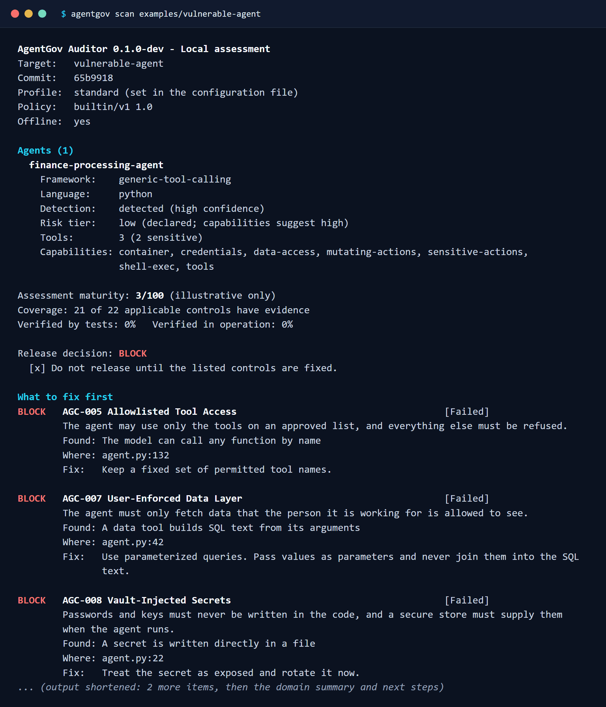
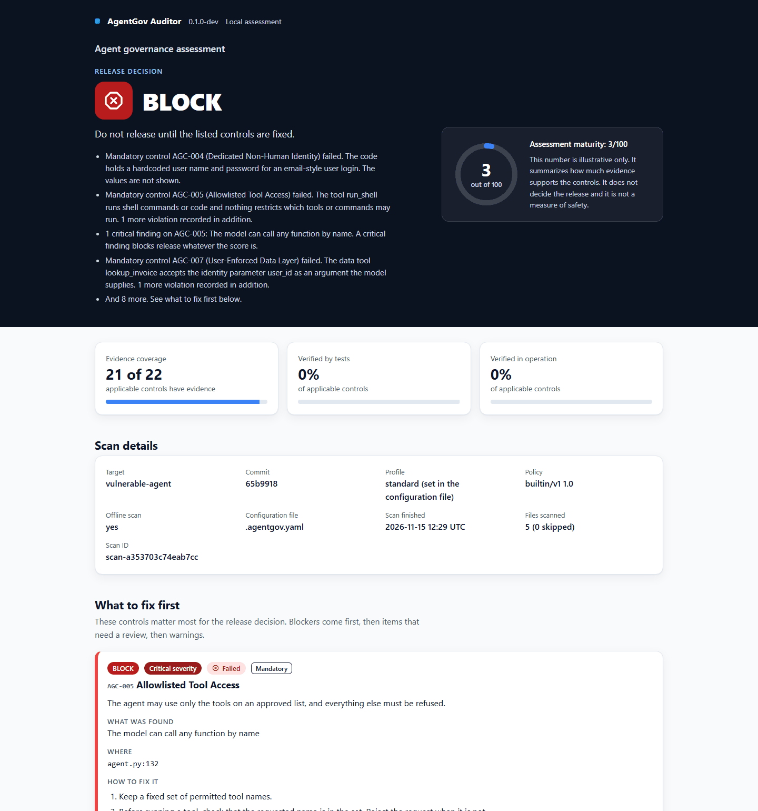
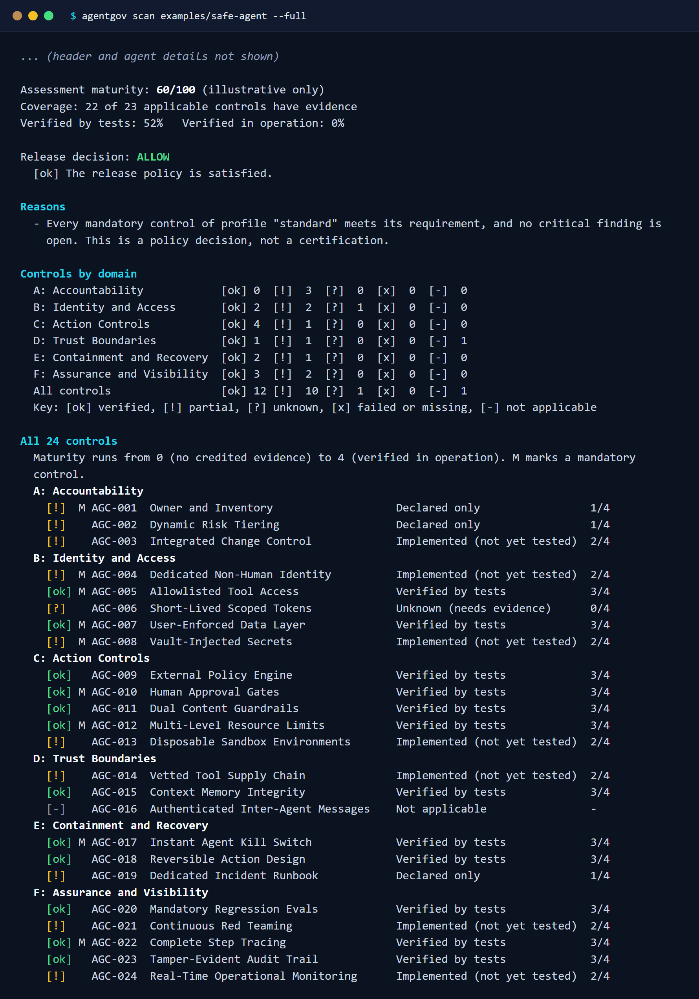
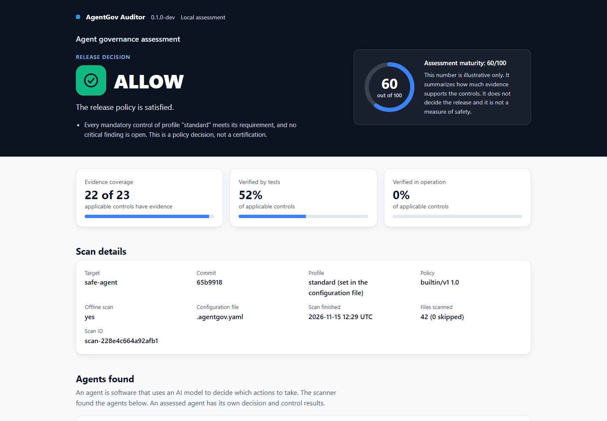
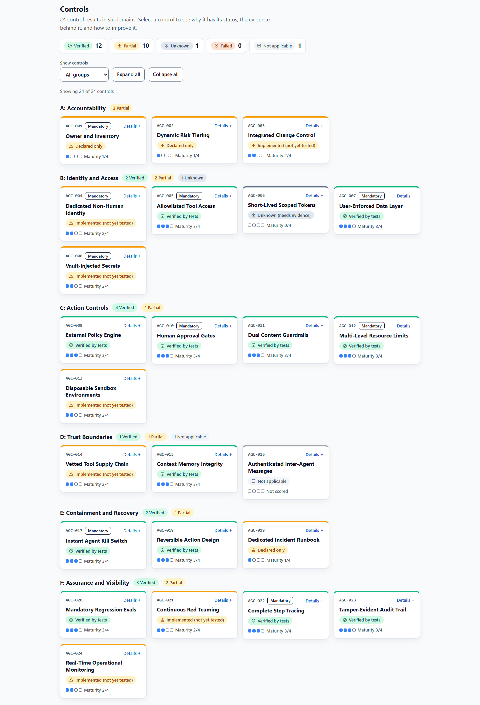
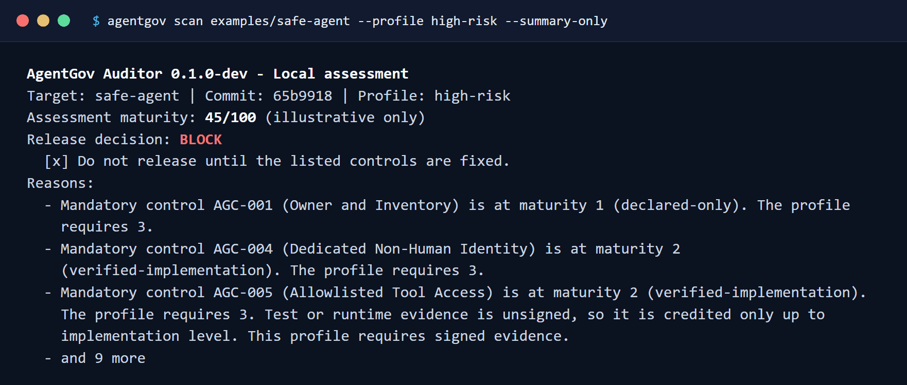
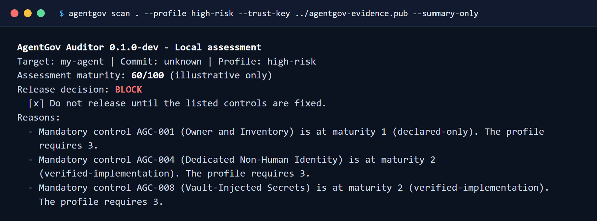
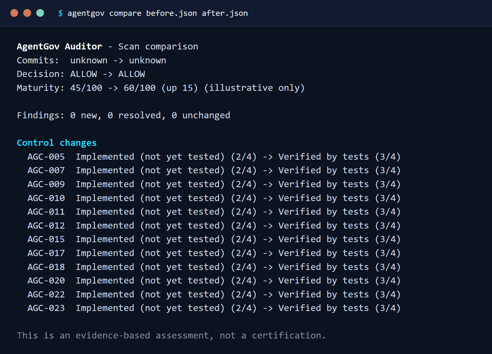
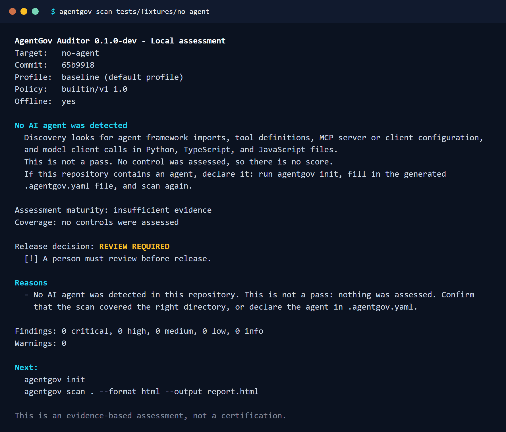

# Demo gallery

Two example agents ship with the repository. One is unsafe on purpose. The other has working controls and tests. This page puts their real results side by side.

Everything here is output of version `0.1.0-dev`. To reproduce it, run the two commands from the repository root:

```sh
agentgov scan examples/vulnerable-agent
agentgov scan examples/safe-agent
```

## At a glance

| | Vulnerable example | Safe example |
| --- | --- | --- |
| Agent | `finance-processing-agent` | `ticket-triage-agent` |
| Tools | 3 (2 sensitive) | 5 (2 sensitive) |
| Profile | standard | standard |
| Release decision | **BLOCK** | **ALLOW** |
| Assessment maturity | 3/100 | 60/100 |
| Coverage | 21 of 22 applicable controls have evidence | 22 of 23 applicable controls have evidence |
| Verified by tests | 0% | 52% |
| Verified in operation | 0% | 0% |
| Findings | 17 (5 critical, 7 high, 5 medium) | 0 |
| Exit code | 1 | 0 |

Controls by status:

| Status | Vulnerable example | Safe example |
| --- | --- | --- |
| Verified in operation | 0 | 0 |
| Verified by tests | 0 | 12 |
| Implemented (not yet tested) | 0 | 7 |
| Declared only | 2 | 3 |
| Missing | 9 | 0 |
| Failed | 10 | 0 |
| Unknown (needs evidence) | 1 | 1 |
| Not applicable | 2 | 1 |

Two things in these tables are worth a second look.

Coverage is nearly the same for both agents. Coverage counts controls for which the scanner found something to judge, good or bad. It is not a quality number.

The safe example scores 60, not 100. Twelve of its controls are proven by tests, seven are in code without tests, and none is proven in operation because nothing is deployed. The tool does not round that up.

## Before: the vulnerable example

### In the terminal



### In the HTML report



### The findings

All 17 findings, as the tool reports them:

| Severity | Control | Finding | Location |
| --- | --- | --- | --- |
| Critical | AGC-005 | The model can call any function by name | agent.py:132 |
| Critical | AGC-007 | A data tool builds SQL text from its arguments | agent.py:42 |
| Critical | AGC-008 | A secret is written directly in a file | agent.py:22 |
| Critical | AGC-008 | A secret is written directly in a file | agent.py:24 |
| Critical | AGC-010 | A sensitive action is approved automatically | agent.py:46 |
| High | AGC-002 | Declared tier lower than detected capabilities | .agentgov.yaml |
| High | AGC-004 | The agent signs in with a hardcoded user or shared account | agent.py:24 |
| High | AGC-005 | A shell or code-execution tool is exposed with no restriction | agent.py:55 |
| High | AGC-007 | Identity supplied by the model | agent.py:40 |
| High | AGC-012 | The agent loop has no step, time, or cost limit | agent.py:138 |
| High | AGC-013 | The container runs as root and the agent can execute commands | Dockerfile:2 |
| High | AGC-022 | A credential is written to logs | agent.py:142 |
| Medium | AGC-001 | A tool exists in code but is missing from the declared inventory | agent.py:55 |
| Medium | AGC-014 | Dependencies are not pinned to exact versions | requirements.txt:1 |
| Medium | AGC-014 | A container image uses the latest tag or no tag | Dockerfile:2 |
| Medium | AGC-017 | The kill flag does not prove termination | agent.py:27 |
| Medium | AGC-022 | Prompts, outputs, or credentials are written to logs without redaction | agent.py:141 |

The secrets in that file are fake. The report still does not print them. It gives the kind of secret, the file, and the line.

Nine more controls are "Missing": change control, a policy engine, guardrails, reversible actions, a runbook, regression tests, red teaming, an audit trail, and monitoring. Missing controls are not findings. A finding is something that breaks a control. A missing control is one the scanner looked for and did not find.

## After: the safe example

### In the terminal



### In the HTML report





### What changed, control by control

| Control | Vulnerable example | Safe example |
| --- | --- | --- |
| AGC-001 Owner and Inventory | Declared only | Declared only |
| AGC-002 Dynamic Risk Tiering | Failed | Declared only |
| AGC-003 Integrated Change Control | Missing | Implemented |
| AGC-004 Dedicated Non-Human Identity | Failed | Implemented |
| AGC-005 Allowlisted Tool Access | Failed | Verified by tests |
| AGC-006 Short-Lived Scoped Tokens | Unknown | Unknown |
| AGC-007 User-Enforced Data Layer | Failed | Verified by tests |
| AGC-008 Vault-Injected Secrets | Failed | Implemented |
| AGC-009 External Policy Engine | Missing | Verified by tests |
| AGC-010 Human Approval Gates | Failed | Verified by tests |
| AGC-011 Dual Content Guardrails | Missing | Verified by tests |
| AGC-012 Multi-Level Resource Limits | Failed | Verified by tests |
| AGC-013 Disposable Sandbox Environments | Failed | Implemented |
| AGC-014 Vetted Tool Supply Chain | Failed | Implemented |
| AGC-015 Context Memory Integrity | Not applicable | Verified by tests |
| AGC-016 Authenticated Inter-Agent Messages | Not applicable | Not applicable |
| AGC-017 Instant Agent Kill Switch | Declared only | Verified by tests |
| AGC-018 Reversible Action Design | Missing | Verified by tests |
| AGC-019 Dedicated Incident Runbook | Missing | Declared only |
| AGC-020 Mandatory Regression Evals | Missing | Verified by tests |
| AGC-021 Continuous Red Teaming | Missing | Implemented |
| AGC-022 Complete Step Tracing | Failed | Verified by tests |
| AGC-023 Tamper-Evident Audit Trail | Missing | Verified by tests |
| AGC-024 Real-Time Operational Monitoring | Missing | Implemented |

AGC-006 is "Unknown" for both. Neither example issues tokens in code, so the scanner has nothing to judge. It says so and does not guess.

AGC-015 applies to the safe example only, because that agent has a memory tool and the vulnerable one does not.

## The same safe agent, blocked

A good score does not buy a release. Scan the safe example with the strictest profile:

```sh
agentgov scan examples/safe-agent --profile high-risk --summary-only
```



The `high-risk` profile requires signed evidence. The example's evidence is unsigned, so the test results are credited only up to level 2 and the score drops to 45.

With signed evidence the score returns to 60, and the release is still blocked. This picture is a starter agent (the same code) whose evidence was signed with `agentgov evidence sign` and scanned with the matching public key:



Three mandatory controls stay below level 3: the owner declaration (AGC-001), the workload identity (AGC-004), and secret injection (AGC-008). The tests in the example do not cover them, so no score can make up for them.

## Watching evidence arrive

A new starter agent has the controls in code and no evidence yet. Running its tests writes the evidence. `agentgov compare` shows the difference between a scan before and a scan after:



## A folder with no agent

For completeness: a folder with an ordinary web application and no agent.



The tool does not give an empty folder a perfect score. It says that nothing was assessed.

## More

- What each example contains: [examples/README.md](../examples/README.md).
- How to read each part of the output: [getting-started.md](getting-started.md#step-4-read-the-result).
- The dashboard screens: [dashboard.md](dashboard.md).
