# Step-by-step guide

This guide takes you from nothing installed to a first result, and then to a check that runs on every change. Each step has one thing to do, a picture of what you should see, and a short note on what it means.

You do not need a security background. If you have never used a terminal, start at Step 0.

Every picture on this page is real output from version `0.1.0-dev`. Where output is long, the picture shows part of it and says so.

## Contents

- [Step 0: What you need](#step-0-what-you-need)
- [Step 1: Install](#step-1-install)
- [Step 2: Check the install](#step-2-check-the-install)
- [Step 3: Try the vulnerable example](#step-3-try-the-vulnerable-example)
- [Step 4: Read the result](#step-4-read-the-result)
- [Step 5: Open the visual report](#step-5-open-the-visual-report)
- [Step 6: Understand one control](#step-6-understand-one-control)
- [Step 7: Scan your own project](#step-7-scan-your-own-project)
- [Step 8: Describe your agent](#step-8-describe-your-agent)
- [Step 9: Start from the governed starter](#step-9-start-from-the-governed-starter)
- [Step 10: Add the check to GitHub](#step-10-add-the-check-to-github)
- [Step 11: Run the dashboard (optional)](#step-11-run-the-dashboard-optional)
- [If something goes wrong](#if-something-goes-wrong)
- [Cheat sheet](#cheat-sheet)

## Step 0: What you need

- A computer with Windows, macOS, or Linux.
- [Go](https://go.dev/dl/) version 1.27 or newer. Go is the language the tool is written in. Download the installer for your system and run it with the default choices.
- [Git](https://git-scm.com/downloads), to download this repository.
- Optional: [Python](https://www.python.org/downloads/) 3, only for Step 9.

You do not need an account, an API key, or an internet connection to scan.

**How do I open a terminal?**

- Windows: press the Windows key, type `PowerShell`, and press Enter.
- macOS: press Command and Space together, type `Terminal`, and press Enter.

A terminal is a window where you type a command and press Enter to run it. If you installed Go or Git a moment ago, close the terminal and open it again so it can find them.

## Step 1: Install

There is no packaged download yet. The project is in alpha, and binaries are planned for the first tagged release. For now you build the tool from its source. It takes three commands and they are the same on every system.

Windows (PowerShell):

```powershell
git clone https://github.com/shahzadarain/agent-governance-auditor.git
cd agent-governance-auditor
go install ./cmd/agentgov
```

macOS or Linux:

```sh
git clone https://github.com/shahzadarain/agent-governance-auditor.git
cd agent-governance-auditor
go install ./cmd/agentgov
```

**What it means.** The first command downloads the project into a folder named `agent-governance-auditor`. The second moves you into that folder. The third builds a program named `agentgov` and puts it in your Go bin folder, so you can run it from anywhere. The first build downloads a few Go libraries and can take a minute. It prints nothing when it succeeds.

Stay in this folder for Steps 2 to 6. The example agents are inside it.

If you do not need the examples, you can skip the clone and install with one command: `go install github.com/shahzadarain/agent-governance-auditor/cmd/agentgov@latest`.

## Step 2: Check the install

```sh
agentgov doctor
```

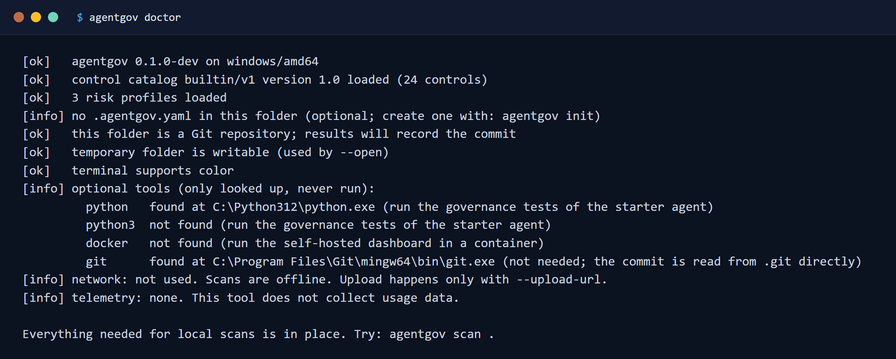

**What it means.** `doctor` checks that the tool and its built-in control list load correctly. Lines marked `[ok]` are fine. Lines marked `[info]` are notes, not problems. The last two lines confirm that scans use no network and that the tool collects no usage data.

If you see "agentgov is not recognized" or "command not found", go to [troubleshooting](troubleshooting.md#agentgov-is-not-recognized-or-command-not-found).

## Step 3: Try the vulnerable example

The repository includes a small agent that is unsafe on purpose. Scan it.

Windows (PowerShell):

```powershell
agentgov scan examples\vulnerable-agent
```

macOS or Linux:

```sh
agentgov scan examples/vulnerable-agent
```

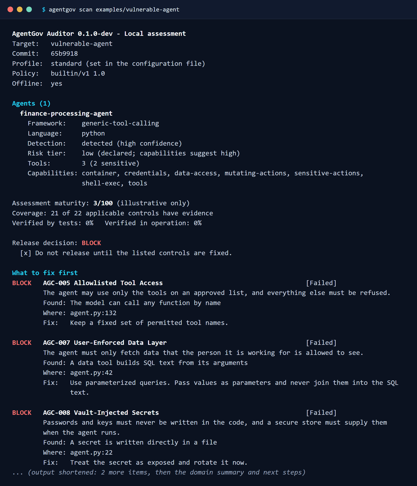

**What it means.** The tool found one agent and decided that it must not be released. That is the correct answer for this example. Nothing was changed and nothing was run: the tool only read the files.

## Step 4: Read the result

The output has six blocks. Read them from top to bottom.

**1. Header.** What was scanned and under which rules.

```text
Target:   vulnerable-agent
Commit:   65b9918
Profile:  standard (set in the configuration file)
Policy:   builtin/v1 1.0
Offline:  yes
```

`Profile` is the set of rules used to decide. There are three: `baseline`, `standard`, and `high-risk`. The text in brackets says where the choice came from. `Offline: yes` confirms that no network was used.

**2. Agents.** What the tool found.

```text
Agents (1)
  finance-processing-agent
    Framework:    generic-tool-calling
    Language:     python
    Detection:    detected (high confidence)
    Risk tier:    low (declared; capabilities suggest high)
    Tools:        3 (2 sensitive)
```

A tool is something the agent can do, such as look up an invoice or send a payment. A sensitive tool is one that changes, sends, deletes, or runs something. Look at the `Risk tier` line: the project's own file says "low", but an agent that can run commands and move money is not low risk. The tool points out the mismatch.

**3. Score.**

```text
Assessment maturity: 3/100 (illustrative only)
Coverage: 21 of 22 applicable controls have evidence
Verified by tests: 0%   Verified in operation: 0%
```

The score is a summary for people. It does not decide anything. `Coverage` says for how many controls the tool found something to judge, good or bad. The last line says how much is proven by tests or by the running system.

**4. Decision.** This is the line that matters.

```text
Release decision: BLOCK
  [x] Do not release until the listed controls are fixed.
```

There are three possible decisions: `ALLOW`, `REVIEW REQUIRED`, and `BLOCK`.

**5. What to fix first.** A short, ordered to-do list.

```text
BLOCK   AGC-005 Allowlisted Tool Access                                     [Failed]
        The agent may use only the tools on an approved list, and everything else must be refused.
        Found: The model can call any function by name
        Where: agent.py:132
        Fix:   Keep a fixed set of permitted tool names.
```

Each item gives the control number and name, the status in square brackets, one sentence that says what the control is, what was found, the file and line, and the first step of the fix.

**6. Controls by domain.** A count for each of the six areas.

```text
Controls by domain
  A: Accountability            [ok] 0  [!]  1  [?]  0  [x]  2  [-]  0
  B: Identity and Access       [ok] 0  [!]  0  [?]  1  [x]  4  [-]  0
  ...
  Key: [ok] verified, [!] partial, [?] unknown, [x] failed or missing, [-] not applicable
```

To see every control with its own status, add `--full`. This picture shows the safe example scanned that way:

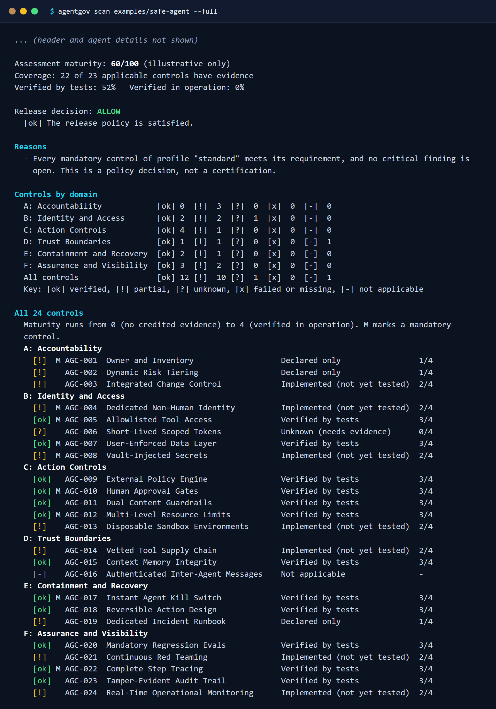

The letter `M` marks a control that the profile requires. The number at the end of each line is the maturity level: 1 means declared, 2 means the code is there, 3 means tests passed, 4 means proven in operation. A scan that only reads code stops at 2.

## Step 5: Open the visual report

Add `--open` to any scan.

```sh
agentgov scan examples/vulnerable-agent --open
```

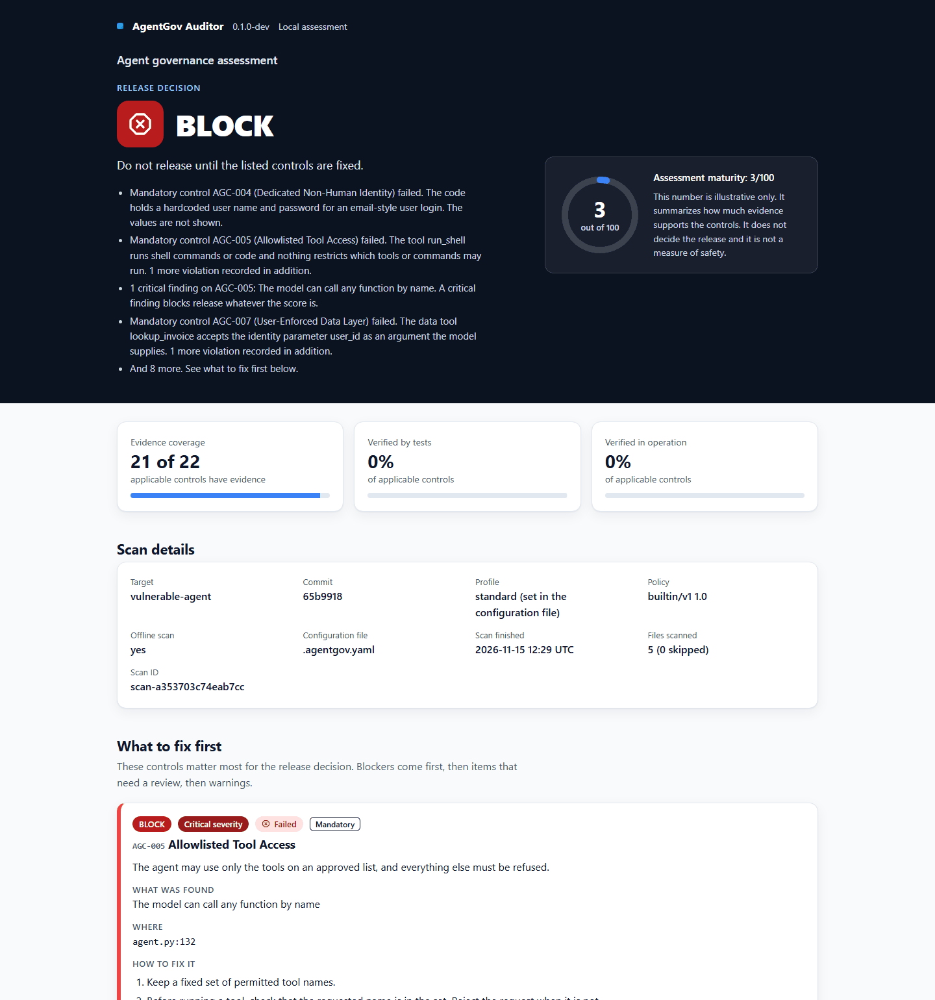

**What it means.** The tool writes one HTML file to your temporary folder and opens it in your browser. The page holds the same information as the terminal, with more detail for each control. It is a single file that works offline, so you can attach it to an email or a ticket.

To save the report in a place you choose:

```sh
agentgov scan examples/vulnerable-agent --format html --output report.html
```

Lower on the page, the 24 controls are shown as cards grouped by domain. This is the safe example:

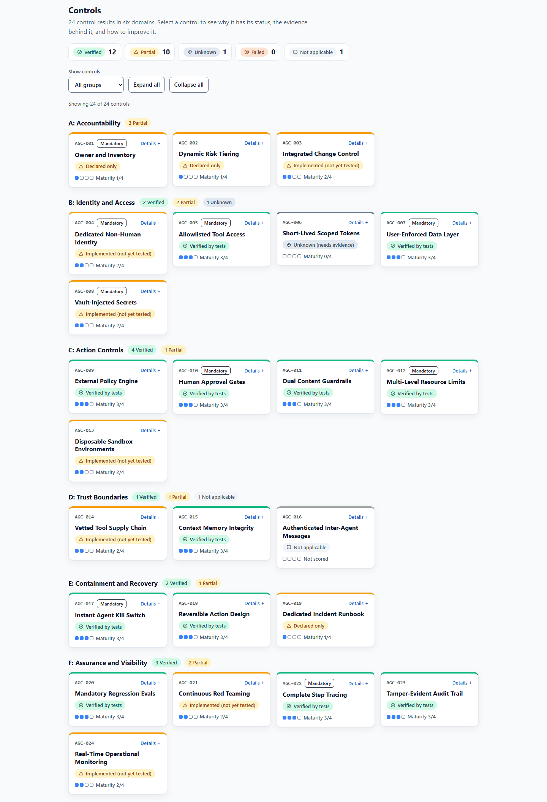

## Step 6: Understand one control

When a control name is unclear, ask for an explanation. You can type the full ID or only the number.

```sh
agentgov explain AGC-010
```

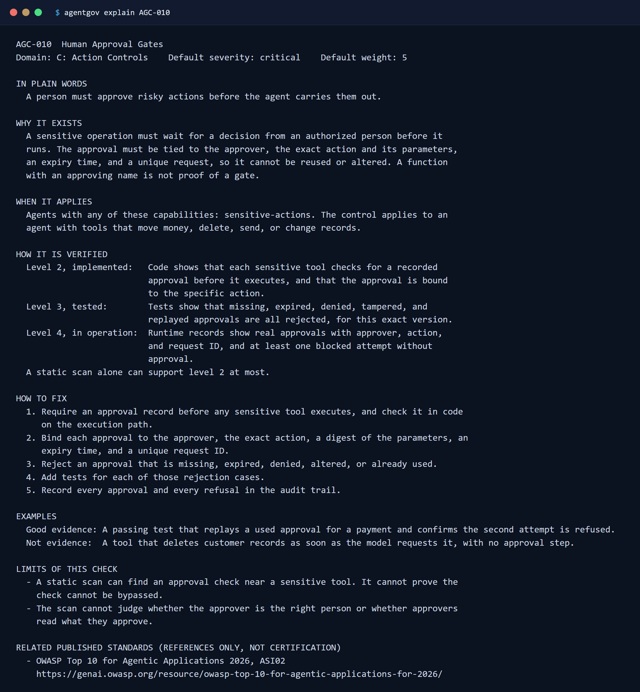

**What it means.** You get the control in plain words, why it exists, what counts as proof at each level, and the steps to fix it. The section "Limits of this check" says what the tool cannot see for this control. To list all 24 controls, run `agentgov controls list`.

## Step 7: Scan your own project

Go to your project folder and scan it. The dot means "this folder".

```sh
cd path/to/your/project
agentgov scan .
```

Three things can happen.

- **An agent is found.** You get a result like the one in Step 3. Start with "What to fix first".
- **No agent is found.** You see this:

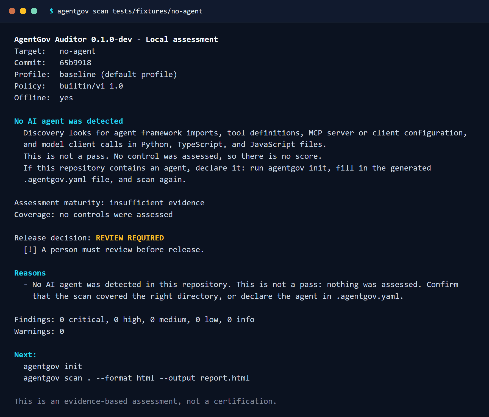

  This is not a pass. Nothing was assessed. The tool looks for agents written in Python, TypeScript, or JavaScript with the frameworks listed in [framework-support.md](framework-support.md). See [troubleshooting](troubleshooting.md#no-agent-was-detected) for what to check.
- **Many controls say "Unknown".** That means the tool could not judge them from the code. It is not a failure and not a pass. See [troubleshooting](troubleshooting.md#many-controls-are-unknown).

## Step 8: Describe your agent

Some controls are about facts that are not in code: who owns the agent, what it is for, how risky it is. You write those in a small file named `.agentgov.yaml`. The tool can create a first version for you.

```sh
agentgov init
```

`init` looks at the folder first and then asks a few short questions: the agent ID, the owning team or person, one sentence about what the agent does, the risk tier, and the data classification. To accept what it detected without questions, add `--yes`:

```sh
agentgov init --yes
```

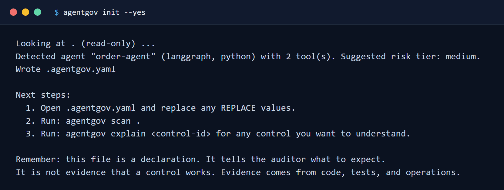

**What it means.** The new file lists the agent, the tools that were detected, and a suggested risk tier. Open it in any text editor and replace the values that start with `REPLACE`. The last two lines of the output matter: this file is a statement, not proof. It raises a control to "Declared only" and no higher.

Check the file after you edit it:

```sh
agentgov policy validate .agentgov.yaml
```

The reference for every setting is [policy-reference.md](policy-reference.md).

## Step 9: Start from the governed starter

If you are building a new agent, start from one that already has the controls and the tests that prove them. This step needs Python 3.

```sh
agentgov new my-agent
cd my-agent
python tools/run_governance_tests.py
agentgov scan .
```

On macOS and Linux the Python command may be `python3`.

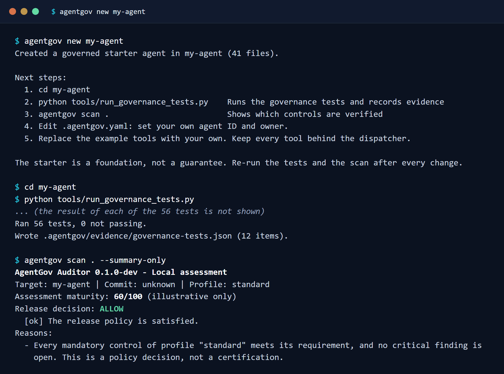

**What it means.** `new` creates a small working agent in plain Python with no extra packages. The test command runs 56 tests that try to break the controls: call a tool that is not allowed, reuse an approval, edit the audit log. It then writes the results to `.agentgov/evidence/governance-tests.json`. The scan reads that file, and twelve controls move from "Implemented" to "Verified by tests".

You can see that change directly. In a fresh starter folder, save one result before you run the tests and one after, and then compare the two files:

```sh
agentgov scan . --format json --output before.json
python tools/run_governance_tests.py
agentgov scan . --format json --output after.json
agentgov compare before.json after.json
```

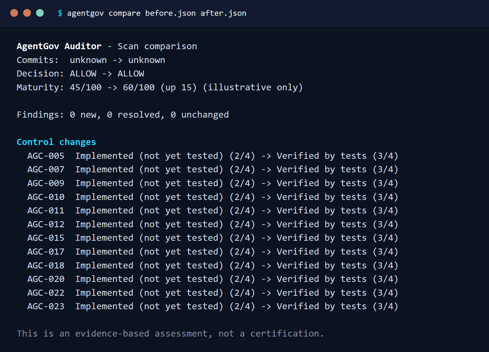

The evidence is tied to the exact content of the files it covers. If you change one of those files, the old evidence stops counting until you run the tests again. That is on purpose. [evidence.md](evidence.md) explains how it works and how to produce evidence from your own tests.

The starter is a foundation, not a guarantee. Replace the example tools with your own, keep every tool behind the dispatcher, and run the tests and the scan again after every change.

## Step 10: Add the check to GitHub

To run the scan on every pull request, add one workflow file to your repository. The quickest way:

```sh
agentgov init --with-workflow
```

That writes `.github/workflows/agentgov.yml` next to the configuration file. If you already have `.agentgov.yaml`, create the workflow file by hand with this content:

```yaml
name: AgentGov

on:
  pull_request:
  push:
    branches: [main]

permissions:
  contents: read

jobs:
  scan:
    runs-on: ubuntu-latest
    steps:
      - uses: actions/checkout@3d3c42e5aac5ba805825da76410c181273ba90b1 # v7.0.1
        with:
          persist-credentials: false
      - uses: shahzadarain/agent-governance-auditor@main
        with:
          path: .
          fail_on: block
```

**What it means.** Each pull request gets a summary on its job page and a set of report files to download. If the decision is `BLOCK`, the check fails and names the control and the file. The scan needs no secrets.

Two things to know:

- The example follows the `main` branch because no release exists yet. For real use, replace `main` with a full commit SHA that you have reviewed.
- A pull request can edit `.agentgov.yaml`. To stop a pull request from lowering your requirements, keep your minimum rules in a file outside the repository and pass it with the `baseline` input.

Both are explained in [github-action.md](github-action.md).

## Step 11: Run the dashboard (optional)

If you have several agents, a dashboard on your own machine can keep track of them. This part is in beta.

```sh
agentgov serve
```

The first start prints a one-time setup token and the address `http://127.0.0.1:8080`. Open the address in a browser, enter the token, and create the administrator account. There is no default password.

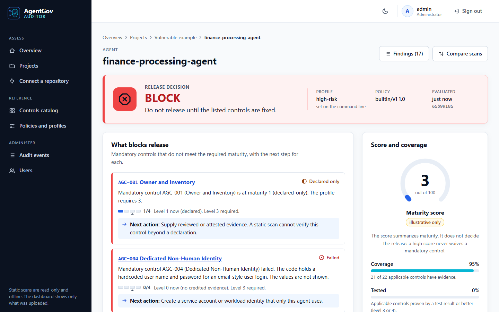

**What it means.** The dashboard listens only on your own machine and stores its data in a local file. Builds can send their scan result to it with `--upload-url`. Only the result is sent, never source code. A tour of the screens is in [dashboard.md](dashboard.md), and running it for a team is covered in [self-hosting.md](self-hosting.md).

## If something goes wrong

[troubleshooting.md](troubleshooting.md) covers the common problems: the command is not found, no color, no agent detected, everything is unknown, a result you think is wrong, and evidence that stopped counting.

If your problem is not there, open an issue and say what you were trying to do. That is useful feedback.

## Cheat sheet

| I want to | Command |
| --- | --- |
| Check that the tool works | `agentgov doctor` |
| Scan the current folder | `agentgov scan .` |
| See every control, not only the top items | `agentgov scan . --full` |
| Open a visual report in the browser | `agentgov scan . --open` |
| Save a report file to share | `agentgov scan . --format html --output report.html` |
| Understand one control | `agentgov explain AGC-010` |
| List all 24 controls | `agentgov controls list` |
| Create the configuration file | `agentgov init` |
| Start a new agent with controls built in | `agentgov new my-agent` |
| See what changed between two saved results | `agentgov compare before.json after.json` |

Every command and flag is listed in [CLI.md](CLI.md).
